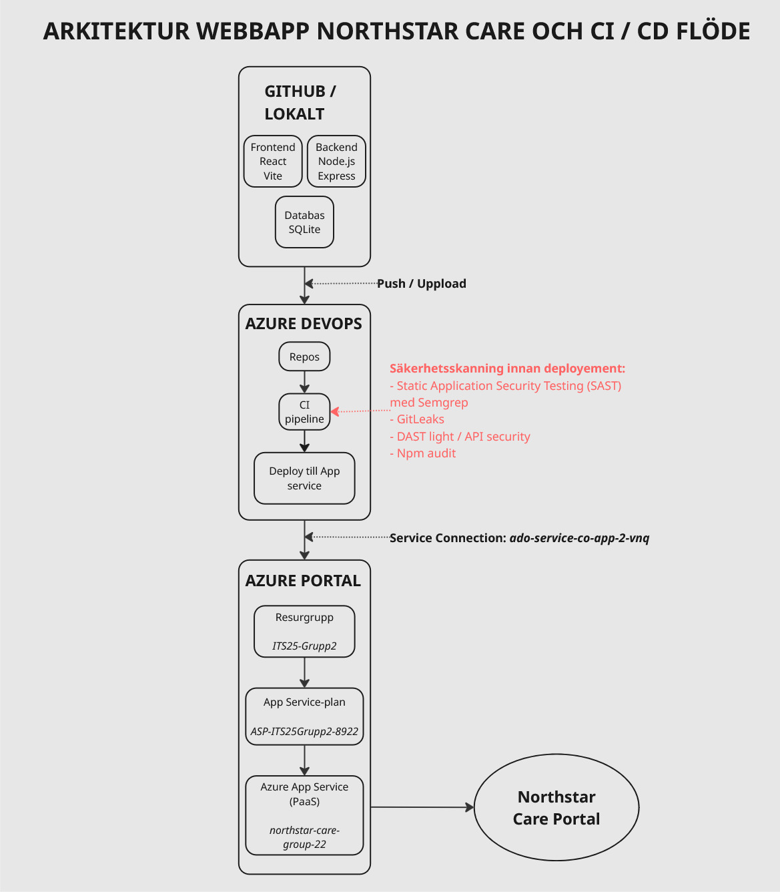

# Northstar Care – DevSecOps, Azure och Defender for Cloud

**Grupp 2** (Albin, Gustav, Valdemar och Vinh)
Med personlig fördjupning och reflektion skriven av Albin Sulejmani

## Innehåll

- [Applikationens struktur](#applikationens-struktur)
- [Molnresurser och infrastruktur](#molnresurser-och-infrastruktur)
- [CI/CD-pipeline](#cicd-pipeline)
- [Secrets och konfigurationshantering](#secrets-och-konfigurationshantering)
- [Säkerhetsanalys](#säkerhetsanalys)
- [Åtgärder](#åtgärder)
- [Sammanfattning](#sammanfattning)
- [Personlig reflektion och fördjupning – Albin Sulejmani](#personlig-reflektion-och-fördjupning--albin-sulejmani)

---

## Applikationens struktur

Northstar Care-portalen är en fullstack-webbapplikation avsedd för vård och interna ärenden inom Northstar Care. Systemet har en trelagersstruktur: frontend (React/Vite), backend (Express) och databas (SQLite). Det körs som en Node.js-process i Azure App Service.

### Applikationens uppbyggnad

Systemet separerar ansvarsområden. Frontend är utvecklad med React och Vite, och backend drivs av Node.js och Express. En viktig detalj är hur de samverkar. I stället för att köra dem på separata servrar byggs frontendkoden till filer som placeras i backends `wwwroot`-mapp. Hela applikationen körs därmed som en process i Azure. Det minskar komplexiteten och förenklar hanteringen av CORS, vilket i längden gör att vi kan stärka säkerheten genom striktare brandväggsregler.

### Arkitektur i Azure

1. **Resursgrupp:** Alla komponenter är samlade i en resursgrupp. Det underlättar säkerhet, kostnader, uppdateringar och livscykelhantering. I det här fallet underlättar det enormt eftersom vi kan isolera vårt projekt från andra gruppers resurser i samma Azure-miljö.
2. **Web app:** Vi skapade en ny resurs (web app) i Azure Portal. Vi kopplade den till *subscription1* och vår grupp *ITS25-Grupp2*, valde *Node 24 LTS* som runtime stack och gav webbappen namnet *northstar-care-group-22*.
3. **Lagringskonto:** Vi skapade lagringskontot `northstarstorage2`, som lagrar loggar och filer. I lagringskontot skapade vi containern `documents`, som vi kopplade till webbappen via miljövariablerna:
   ```
   AZURE_STORAGE_CONNECTION_STRING = <anslutningssträng>
   AZURE_STORAGE_CONTAINER_NAME    = documents
   ```
4. **Azure DevOps och repo:** Källkoden finns i ett Git-repository i Azure DevOps. Det är kärnan i vår CI/CD-pipeline.

#### Repots uppbyggnad

```
/With-blob
├── .Pipelines-extrasec_test.yml   # Automatiserad säkerhet och deployment
├── /Backend
│   ├── /server
│   │   ├── /storage               # Logik för filhantering
│   │   ├── /middleware            # Autentisering och indatavalidering
│   │   ├── /routes                # API-endpoints: hanterar trafikvägar
│   │   ├── /services              # Applikationens interna funktioner
│   │   ├── index.js               # Integrerar applikationen
│   │   └── app.js                 # Huvudapplikation och API-endpoints
│   ├── /wwwroot                   # Destination för byggd frontend-kod
│   ├── /tests                     # Automatiserade backend-tester
│   └── package.json               # Backend-beroenden
│
├── /Frontend
│   ├── /src                       # Frontend-källkod och komponenter
│   │   ├── /app
│   │   │   ├── api.js             # Centraliserad hantering av API-anrop till backenden
│   │   │   └── auth.jsx           # Hanterar inloggning och sessioner
│   │   ├── /pages                 # Sidstrukturer
│   │   └── /tests                 # Vitest-tester för frontenden
│   ├── vite-config.js             # Konfiguration för optimering
│   └── package.json               # Frontend-beroenden
│
├── Pipelines-extrasec_test.yml    # Pipeline
└── README.md
```

### Motivering av repots uppbyggnad

- **Separation av miljöer:** Eftersom backend och frontend ligger i separata mappar kan vi köra specifika säkerhetsanalyser på varje del oberoende av varandra.
- **Byggprocessen:** Pipelinen bygger frontenden i `backend/wwwroot`. Det minskar komplexiteten eftersom bara ett paket behöver skickas till Azure App Service.
- **Modulär lagring:** Logiken för lagring är isolerad från resten av applikationen. Det gör det enkelt att byta mellan lokal lagring och Azure Blob Storage med hjälp av miljövariabler, utan att ändra källkoden.



---

## Molnresurser och infrastruktur

Vi kör Azure App Service (Linux). Medan vi laborerade upptäckte vi att vi hade valt fel resursnivå, och när det var åtgärdat kvarstod problem med att kvoten överskreds. Vi märkte då att Free-planen användes i stället för Basic (B1). När vi bytte överskreds inte kvoten längre.

Det här är viktigt eftersom det kan leda till att applikationen stängs ner. I en vårdkontext kan det innebära avbrott i tjänsteleveransen och få hårda konsekvenser för företag och patienter. Det belyser också hur svårnavigerat Azure kan vara: fast man tror att rätt resursnivå eller grupp är vald kan det finnas inställningar som överskrids.

Azure-resurser vi använde:

| Resurs | Namn |
|---|---|
| Subscription | Azure Subscription 1 |
| Resource Group | ITS25-Grupp2 |
| App Service | northstar-care-group-22 |
| App Service Plan | Basic B1 (Linux) |
| Storage Account | northstarstorage2 |
| Blob Container | documents |
| Service Connection | ado-service-co-app-2-vnq |

### Roller och rättigheter

Hanteringen av identiteter och rättigheter var det största hindret i labben. Det visar vilka svårigheter som kan uppstå med identitetshantering i hybridmiljöer.

### Azure DevOps och Azure Portal

Det är stor skillnad mellan rättigheter i Azure DevOps och i Azure Portal. I Portal styr vi vem som får ändra på själva webbappen, repos och pipeline.

- **Identitetsproblematik:** Vi stötte på betydande hinder vid inloggning på grund av två olika domäner (`@learnet.se` och `@azurenodehill.onmicrosoft.com`).
  - Vissa som loggade in via Learnet-domänen fick inte tillgång till alla resurser, och andra kunde inte logga in alls. Inloggning via Node Hill-domänen verkade fungera.
  - De som loggade in via Node Hill-domänen fick Contributor-behörighet, medan de med Learnet-domänen fick Admin. Det gjorde att de med Contributor-rollen inte kunde committa till main-branchen eller komma åt alla resurser.
  - Det visade tydligt hur viktigt det är med rätt behörigheter och prenumerationer för att få tillgång till resurserna på plattformen.
- **Service Connections:** För att överbrygga gapet mellan DevOps och Azure använde vi Service Connection `ado-service-co-app-2-vnq`, som fungerar som en Service Principal. I stället för att enskilda användare behöver fulla adminrättigheter i Azure har pipelinen fått de rättigheter som krävs för att deploya koden. Det följer principen om Least Privilege.

---

## CI/CD-pipeline

Vår pipeline är definierad som kod i `azure-pipelines.yml`. Det är en viktig del av DevSecOps: säkerhetskontroller och tester är automatiserade och körs vid varje kodändring.

Pipelinen innehåller fyra säkerhetsskanningar som fungerar som gates och stoppar kod innan den når produktion. Gaten skyddar tre nivåer:

- **koden:** SAST och secrets scanning
- **beroendena:** npm audit
- **leveransen:** säkerhetstester (DAST/API)

Pipelinen genererar också en artifact (`ci-report`) med säkerhetsresultaten och testresultaten för frontend och backend. Alla resultat summeras i filen `ci-summary`.

### Pipelinens steg och logik

1. **Miljöförberedelse:** Pipelinen startar en Ubuntu-agent och installerar rätt Node.js-version.
2. **Dependency management:** `npm ci` säkerställer att pipelinen installerar exakt samma biblioteksversioner som användes under utvecklingen. Det förhindrar att nya sårbarheter kommer in via uppdaterade paket.
3. **SAST med Semgrep:** Analyserar koden för att hitta möjliga injection-risker, XSS-problem och osäkra mönster.
4. **Secrets scanning med Gitleaks:** Skannar repot efter läckta API-nycklar, tokens och lösenord. Steget stoppar inte pipelinen om hemligheter hittas (`|| true`), så vi måste kontrollera `ci-report` vid fynd.
5. **Verify Hosting:** Backend startas i pipelinen och en curl-förfrågan körs mot `/health`. Om appen inte kan starta avbryts deployen. Det förhindrar att en fungerande webbapplikation tas ner av dålig kod.
6. **API-säkerhet och DAST light:** Testet behöver köras mot en körande applikation och ligger därför efter Verify Hosting. Det letar efter auth-problem, öppna endpoints och säkerhetsbrister i API:et, och kontrollerar security headers (saknad X-Frame-Options och CSP).
7. **Automatiserade tester (Vitest):** Vi kör frontend- och backendtester med Vitest och exporterar rapporten som JUnit:

   ```yaml
   # Kör frontend-tester med Vitest och exporterar JUnit-rapport.
   - script: npx vitest run --reporter=junit --outputFile="$(reportDir)/frontend-junit.xml"
     displayName: "Run frontend tests"
     workingDirectory: "$(Build.SourcesDirectory)/Frontend"
   ```

   Sedan publiceras JUnit-rapporterna direkt i webbgränssnittet:

   ```yaml
   # Publicerar frontendens JUnit-resultat även om tidigare steg har misslyckats.
   - task: PublishTestResults@2
     displayName: "Publish frontend test results"
     condition: succeededOrFailed()
     inputs:
       testResultsFormat: "JUnit"
       testResultsFiles: "$(reportDir)/frontend-junit.xml"
       testRunTitle: "Frontend Vitest"
       failTaskOnFailedTests: true
   ```

   Det gör att man direkt ser vilka moduler som brister utan att leta i loggfiler. Det förkortar Mean Time To Repair (MTTR), eftersom vi snabbt kan se om någon funktionalitet har gått sönder.
8. **Sårbarhetsskanning (npm audit):** Alla tredjepartsbibliotek analyseras efter kända sårbarheter.
9. **Deploy:** Sker via AzureWebApp-tasken med Service Connection `ado-service-co-app-2-vnq` mot `northstar-care-group-22`. Deployen körs bara när alla tidigare steg har passerat.
10. **Report build status:** Gör en rapport över vad som har gjorts.

### Deployment

1. **Paketering:** Pipelinen tar innehållet i backenden (som även innehåller den färdigbyggda frontenden i `wwwroot`) och skapar en zip-fil.
2. **Verifiering:** Skriptet letar efter specifika filer, till exempel `AzureBlobStorage.js`, och kontrollerar att rätt bibliotek finns i `package.json`.
3. **Driftsättning:** Pipelinen använder Service Connection `ado-service-co-app-2-vnq` för att få behörighet att ändra i resursgruppen. Sedan laddas zip-filen upp som `app.zip` till webbappen.
4. **Omstart:** Till sist startas Node.js-servern om så att den nya koden blir tillgänglig för alla användare.

---

## Secrets och konfigurationshantering

Säker hantering av hemligheter är särskilt viktig i en molnmiljö. I vår pipeline har vi gått från att bara dölja data till att aktivt skanna efter den.


När vi granskade koden hittade vi olika konfigurationsbehov i `server/index.js`, `server/config/runtimePaths.js` och `server/app.js`. Utöver variablerna i tabellen nedan hanterade vi `SCM_DO_BUILD_DURING_DEPLOYMENT`. Den säger åt Azure App Service att bygga koden och köra nödvändiga skript, som `npm install`, vid driftsättningen.

| Variabel | Känslighetsnivå | Syfte |
|---|---|---|
| `JWT_SECRET` | Hemlig | Signerar och verifierar JWT-tokens. Kritisk, eftersom ett känt värde ger full kontroll över autentiseringen. |
| `AZURE_STORAGE_CONNECTION_STRING` | Hemlig | Autentisering mot Azure Blob Storage. Innehåller kontonyckeln. |
| `AZURE_STORAGE_CONTAINER_NAME` | Konfiguration | Namnet på Blob-containern (`documents`). |
| `STORAGE_TYPE` | Konfiguration | Väljer mellan `local` och `azure` som lagringsbackend. |
| `NODE_ENV` | Konfiguration | Talar om för appen om den körs i till exempel development eller production. Styr beteendet, till exempel mer debuginformation eller säkrare körning i produktion. |
| `PORT` | Konfiguration | Sätts automatiskt av App Service och behöver inte konfigureras manuellt. |

### Hantering av JWT_SECRET

En kritisk och känslig del av konfigurationen är `JWT_SECRET`. I källkoden (`server/index.js`) upptäckte vi att applikationen använder det hårdkodade fallbackvärdet `"northstar-dev-secret"`. Eftersom värdet syns i Git-historiken är det en allvarlig säkerhetsbrist. Vem som helst kan använda det för att förfalska JWT-tokens och få åtkomst.

Rätt åtgärd är att skapa en unik `JWT_SECRET` i App Service Application Settings och sedan ta bort fallbackvärdet ur källkoden, så att applikationen vägrar starta om nyckeln saknas.

### Hur vi valde att lagra

`AZURE_STORAGE_CONNECTION_STRING`, `AZURE_STORAGE_CONTAINER_NAME` och `STORAGE_TYPE` lade vi in som App Service Application Settings i Azure Portal. Värdena hämtades från lagringskontot `northstarstorage2` under *Säkerhet och nätverk → Åtkomstnycklar → Anslutningssträng*. På så sätt injiceras de som miljövariabler vid körning och syns inte i källkoden eller i pipelineloggarna.

---

## Säkerhetsanalys

### Problem vi hittade

**Ingen rate-limiting vid inloggning.** `authController.js` verkar inte ha någon rate-limiting för lösenord och är därmed öppen för brute-force-attacker:

```js
const result = authService.login({ username, password });
if (!result) {
  return res.status(401).json({ error: "Invalid credentials" });
}
```

**Ingen rate-limiting för tokens.** Samma sak gäller `auth.js`. Det saknas rate-limiting för tokens, vilket kan innebära risk för brute-force-attacker mot dem:

```js
const decoded = jwt.verify(token, jwtSecret);
if (decoded.jti && authRepository.isTokenRevoked(decoded.jti)) {
  return res.status(401).json({ error: "Invalid token" });
}
```

**Ingen inputvalidering i assistant-endpointen.** I `backend/routes/assistant.routes.js` definieras endpointen så här:

```js
router.post("/ask", authMiddleware, assistantController.ask);
```

Endpointen är skyddad av autentisering via `authMiddleware`, men vi såg ingen inputvalidering på route- eller controllernivå. I `controllers/assistantController.js` såg vi följande:

```js
const question = req.body?.question;
const result = assistantService.ask({ question, user: req.user });
```

Det visar att `question` inte valideras och att användarinput skickas direkt vidare till servicelagret utan filtrering. Ogiltig eller extrem input kan alltså nå backendlogiken. Vi testade det genom att anropa `/api/assistant/ask` med fetch i webbläsarkonsolen, med en payload på 100 000 tecken:


Requesten accepterades och returnerade ett giltigt svar. Med en payload på 1 000 000 tecken returnerade servern däremot HTTP 500 Internal Server Error. Det tyder på att inputstorleken inte begränsas tidigt i requestkedjan. Om ett konto blir hackat och missbrukas kan det leda till onödig resursförbrukning och instabilitet.

Vi testade också systemets robusthet med ett belastningstest i k6: ett skript skickade cirka 400 requests under 30 sekunder. Azure App Service-metrics (under Monitoring) visade:

- **Response time:** 34,46 s
- **CPU time:** 3,52 s (låg CPU men hög latens)
- **Totalt antal requests:** 453


Systemet kraschade inte under belastningen, men latensen ökade kraftigt, vilket tyder på begränsad skalbarhet.

Sammantaget innebär avsaknaden av tidig inputvalidering och tydliga begränsningar (till exempel max payloadstorlek och rate-limiting) en risk för ökad resursförbrukning. Vid missbruk av autentiserade konton kan det bidra till sämre prestanda och DoS-liknande beteende. Vi prioriterade inte detta, eftersom vi bedömde risken som låg till medelhög.

> **Förslag på åtgärd:** Lägg till inputvalidering och rate-limiting direkt i källkoden, och skapa en alert rule i Azure Monitor som triggas vid ovanligt många requests.

**Trust boundary violation när ärenden skapas.** Vi testade om det gick att manipulera skapandet av ett ärende. Vi följde flödet routes → controller → services och tittade i `backend/casesService.js`:

```js
createCase: ({ payload, user }) => {
  const created = casesRepository.create({
    externalRef: payload.externalRef || nextExternalRef(),
    title: payload.title,
    description: payload.description,
    status: payload.status || "open",
    priority: payload.priority || "medium",
    assignedUserId: payload.assignedUserId ?? user.id,
    team: payload.team || "support"
  });
```

Där identifierade vi en potentiell trust boundary violation. Vi anropade `/api/cases` direkt med fetch i webbläsarkonsolen, inloggade som `anna.support`:


Requesten accepterades och returnerade ett giltigt svar. Ärendet skapades av anna.support men blev synligt bara för mikael.manager, vilket inte borde vara möjligt.

### Hur vi prioriterade dem

Först prioriterade vi problemen som pipelinen hittade, sedan de kritiska problemen från Microsoft Defender.

### Vad som upptäcktes i Defender, pipelinen och applikationen

#### Pipeline

Pipelinen hittade inget kritiskt säkerhetsproblem, förutom fem sårbarheter med severity *moderate* från npm audit.


När vi körde `npm audit` lokalt i `./Backend` och `./Frontend` fick vi fler detaljer och rekommendationer: dev-beroendena Vite och Vitest behövde uppdateras.


#### Defender för webbappen

Defender hittade en kritisk och en låg risk gällande anonym åtkomst och exponering mot internet. Rekommendationerna var:

- **Kritisk:** *Managed identity should be enabled on web apps*, för att minska risken med komprometterade hemligheter och öka säkerheten vid åtkomst till Azure-resurser.
- **Låg:** *Diagnostic logs in App Service should be enabled*, för att kunna utreda säkerhetsincidenter och nätverksintrång.

#### Defender för lagringskontot northstarstorage2

Defender hittade en hög och två låga risker gällande exponering mot internet. Rekommendationerna var:

- **Hög:** Inaktivera den delade nyckeln och låt bara Azure AD auktorisera åtkomst till lagringskontot.
- **Låg:** Säkra kommunikationen med lagringskontot via en privat endpoint (Private Link), för att minska risken för dataintrång och obehörig åtkomst.
- **Låg:** *Storage accounts should restrict network access using virtual network rules*. Lagringskontot är i dag publikt exponerat, vilket innebär en risk för datasäkerheten.

#### Identifierade problem

1. **Läckta credentials:** Risken att hemligheter hamnar i källkoden hanteras nu med Gitleaks.
2. **Tillgänglighetsrisker:** Kvotproblemen med Free-planen visade ett stort tillgänglighetsproblem, eftersom tjänsten bara kunde vara uppe cirka 60 minuter per dag.
3. **Beroenderisker:** npm audit visade att vi har beroenden med kända sårbarheter. Det är en ständig risk när man förlitar sig på kod skriven av andra. På grund av tidsbrist, och risken att något skulle sluta fungera, valde vi att inte åtgärda de fem beroendena med severity *moderate*. De bör dock åtgärdas inom rimlig tid.
4. **Konfigurationsfel:** Svårigheterna med att få Azure Blob Storage att fungera visade riskerna med manuell konfiguration.

### Säkerhetsmässiga styrkor

1. **Token revocation:** Koden saknar rate-limiting, men den kör `authService.login` och returnerar 401 direkt om resultatet är falskt. En viktig styrka är att koden kontrollerar om en token har spärrats (`isTokenRevoked`). Det gör det möjligt att omedelbart göra stulna tokens obrukbara vid utloggning.

   

2. **Automatiska säkerhetstester:** Vi integrerade fyra automatiska säkerhetstester i pipelinen: SAST, secrets scanning, DAST och dependency scanning. Tillsammans blir de ett starkt filter som stoppar sårbarheter innan de når molnet.

   

3. **Managed identity:** Vi tog bort behovet av att spara känsliga lösenord för interna Azure-tjänster genom att aktivera systemtilldelad identitet. Webbappen har då bara de rättigheter den behöver, enligt Least Privilege-principen. Det aktiverades under *Inställningar → Identitet → Systemtilldelad*.

---

## Åtgärder

### Vilka åtgärder som genomfördes

**Uppdatering av backend:**
```
Updating vitest to 4.1.5, which is a SemVer major change.
added 14 packages, removed 17 packages, changed 16 packages, and audited 216 packages in 13s
```

**Uppdatering av frontend:**
```
npm warn audit Updating vite to 8.0.9, which is a SemVer major change.
npm warn audit Updating vitest to 4.1.5, which is a SemVer major change.
added 176 packages, and audited 177 packages in 6s
```

**Test:** Webbappen fungerar lokalt.

- **Managed identity:** Webbappar bör använda hanterad identitet. Vi aktiverade det för `northstar-care-group-22` under *Inställningar → Identitet → Systemtilldelad*.
- **Diagnostic settings:** Vi skapade diagnostic setting "Loggar-Grupp 2" under *Monitoring → Diagnostic settings*. Den skickar App Service Application Logs, Access Audit Logs, IPSecurity Audit Logs, App Service Authentication Logs (preview) och AllMetrics till lagringskontot. Vi saknade behörighet att skapa en workspace i Application Insights och koppla loggarna dit.

**Extra säkerhet:**

- **Data retention i Blob:** För att minska risken att känslig data lagras för länge lade vi till en regel i Azure Lifecycle Management för `northstarstorage2`. Dokument som inte har ändrats på 365 dagar raderas. Det minskar exponeringen vid dataläckor och följer dataminimeringsprincipen.

  

- **Redundans för lagringskontot:** Vi aktiverade geo-redundant lagring (GRS) som skydd mot tillfälliga hårdvarufel, nätverks- och strömavbrott och naturkatastrofer. Däremot kunde vi inte skapa backup-vaulten `BackupBlobGrupp2` (geo-redundant, soft delete med 14 dagars retention) för Azure Backup for blobs, på grund av saknade behörigheter.

### Vilka problem som återstår

**Hårdkodad JWT-hemlighet.** Ett kritiskt fynd gjordes i `server/index.js`:

```js
const JWT_SECRET = process.env.JWT_SECRET || "northstar-dev-secret";
```

Fallbackvärdet `"northstar-dev-secret"` är ett hårdkodat standardlösenord som syns publikt och nu ligger i Git-historiken. Om `JWT_SECRET` inte sätts i App Service-konfigurationen körs applikationen med det kända värdet. Då kan vem som helst förfalska JWT-tokens och logga in som valfri användare, även admin.

Bästa sättet att hantera det hade varit att både sätta `JWT_SECRET` som Application Setting i App Service och ta bort fallbackvärdet ur koden, så att applikationen inte startar om variabeln saknas. Det ändrade vi inte, men det bör åtgärdas innan applikationen tas i bruk.

Hemligheter ska inte ligga i repot eftersom Git-historiken är permanent. Även om ett värde tas bort i en ny commit finns det kvar i historiken och är lätt att hitta.

**Övriga problem:**

- **Shared key access:** Vi stängde av *Allow storage account key access* i `northstarstorage2` (*Settings → Configuration*) och gav Grupp 2 rollen Storage Blob Data Contributor under *Access Control (IAM)*. Webbappen tappade då åtkomsten till lagringskontot, till exempel för att ladda upp dokument. Källkoden behöver nämligen skrivas om så att den inte använder connection string mot Blob:
  ```js
  const azureConnectionString = env.AZURE_STORAGE_CONNECTION_STRING || "";
  ```
  Det krävde mer tid och djupare programmeringskunskaper, så vi valde att vänta med det.
- **Nätverksåtkomst:** Åtkomsten till lagringskontot bör begränsas med en virtuell nätverksregel och en privat endpoint.
- **Defender for Storage:** Aktivering av Microsoft Defender for Storage skulle upptäcka hot mot känslig data och skanna uppladdningar efter malware. Det innebär dock en extra kostnad.

### Hur säkerhetsnivån förbättrades

Genom DevSecOps-pipelinen och flytten till Azure har vi gått från reaktiv säkerhet till en proaktiv och automatiserad process. Säkerhetsnivån har förbättrats mest inom följande områden.

**1. Automatiserade säkerhetskontroller (security gates)**
Den största förbättringen är de automatiserade gaten i CI/CD-pipelinen. Vi har gått från att dölja känslig data till att aktivt skanna efter den.
- **SAST:** Semgrep analyserar koden vid varje push för att hitta injection-risker, XSS-problem och osäkra kodmönster.
- **Secrets scanning:** Gitleaks säkerställer att inga API-nycklar eller lösenord läcker via källkoden.
- **Beroendehantering:** npm audit hittar sårbarheter i tredjepartsbibliotek. Vi har bland annat åtgärdat sårbarheter genom att uppdatera Vite och Vitest.
- **DAST light och API-säkerhet:** Vi testade applikationen mot vanliga hot och kontrollerade att security headers som CSP och X-Frame-Options är korrekt konfigurerade.

**2. Infrastruktur och identitetshantering**
Säkerheten i molnmiljön har stärkts genom att vi följt grundläggande principer för molnsäkerhet:
- **Managed identity:** Systemtilldelad identitet för webbappen minskar behovet av att hantera och lagra hemligheter manuellt, och därmed risken att de hamnar fel.
- **Least Privilege:** Med en Service Connection (Service Principal) mellan Azure DevOps och Azure behöver enskilda utvecklare inga administrativa rättigheter. Pipelinen har bara de rättigheter som krävs för deployment.

**3. Tillgänglighet och övervakning**
Tillgänglighet är en viktig del av säkerheten.
- **Från Free till Basic:** Bytet från Free-planen till Basic B1 tog bort risken för avbrott på grund av kvotbegränsningar, vilket är kritiskt för en app inom vården.
- **Loggning och incident response:** Diagnostic setting "Loggar-Grupp 2" skickar audit- och autentiseringsloggar till lagringskontot. Det gör det lätt att utreda säkerhetsincidenter i efterhand.
- **Health checks:** Pipelinen kontrollerar applikationens hälsa (`/health`) innan en deployment slutförs, så att trasig kod inte tar ner tjänsten.

---

## Sammanfattning

Syftet med projektet har varit att bygga en digital infrastruktur för en onlinevårdcentral, Northstar Care. Fokus har legat på en miljö som är enkel att hantera och har utrymme att växa, med säkerheten i åtanke.

### Skapandet av resurser i Azure

Azure App Service är systemets motor, där själva programkoden körs. För att hämta och lagra patientfiler säkert är den kopplad till ett lagringskonto. I stället för att skriva in lösenord i koden, vilket skapar säkerhetsbrister, används miljövariabler. De injiceras i App Service vid start, så att applikationen vet hur den ska kommunicera med lagringskontot utan att säkerhetsnycklar syns i källkoden.

### Pipeline

Pipelinen var en central del av projektet. Den är inte bara en byggprocess som deployar från DevOps till vår Azure-prenumeration via en Service Connection, utan också ett tidigt och kontinuerligt säkerhetsflöde. Säkerhetsskanningarna längs hela processen gör att upptäckta risker och sårbarheter hanteras innan koden når produktion.

### Automatiserad säkerhetsgranskning

- **Vad vi har gjort:** Varje ny ändring i portalen måste passera automatiserade säkerhetskontroller innan den släpps ut. Systemet letar själv efter svagheter i koden, läckta lösenord och brister i de externa verktyg vi använder.
- **Varför det är viktigt:** Människor gör misstag, och säkerhetshot utvecklas snabbt. Automatiserade tester stoppar säkerhetsbrister innan de når portalen. Det gör att vi kan arbeta effektivt utan att tumma på säkerheten.

### Datahantering och driftsäkerhet

- **Vad vi har gjort:** För att skydda patientdata har vi, utöver de automatiserade granskningarna, infört automatisk rensning som raderar gamla dokument efter 365 dagar. Vi har också utökat loggningen och infört en hälsokontroll som verifierar att portalen fungerar innan en uppdatering släpps igenom.
- **Varför det är viktigt:** Att spara data längre än nödvändigt är en onödig risk. Automatisk rensning följer principen om dataminimering och minskar skadan vid en eventuell dataläcka. Hälsokontrollerna och övervakningen ser till att trasig kod inte kan krascha hela portalen.

### Återstående problem

- **Hårdkodad hemlighet:** Det hårdkodade reservlösenordet i källkoden är en kritisk säkerhetsbrist. Det syns för alla och kan användas av den som vet hur.
- **Varningar i Defender:** För webbappen gäller managed identity och diagnostic logs. För lagringskontot gäller publik exponering och shared keys.
- **Beroenden:** Vi använder äldre versioner av tredjepartsbibliotek, vilket kan ge en angripare en väg in.
- **Rate-limiting och inputvalidering saknas:** Vi skyddar inte mot brute-force- eller traversal-attacker.

### Slutsats

Med en automatiserad DevSecOps-pipeline i Azure har Northstar Care gått från en reaktiv till en proaktiv applikation. Automatiserade säkerhetskontroller, systemtilldelade identiteter och en uppgraderad servermiljö ger nu en stabil och skyddad plattform. Några brister i kod och konfiguration återstår att åtgärda innan applikationen publiceras på riktigt, men projektet har stärkt systemets säkerhet och tillgänglighet överlag.

---

## Personlig reflektion och fördjupning – Albin Sulejmani

Det svåraste var utan tvekan identitets- och behörighetshanteringen i Azure. De olika domänerna (`@learnet.se` och `@azurenodehill.onmicrosoft.com`) gjorde att gruppmedlemmar fick olika roller (Contributor eller Admin) och att vissa inte fick tillgång till resurser vi behövde alls. Det hindrade oss från kritiska uppgifter som att committa till main eller hantera resurser.

Det är lätt att underskatta hur komplex hybrid identitetshantering är i Azure. Det räcker inte att "lägga till någon i projektet": roller, prenumerationer och domänkopplingar måste stämma på flera nivåer samtidigt. Det kostade oss mycket tid som annars kunde ha gått till säkerhetsförbättringar i koden.

Det mest värdefulla var insikten om DevSecOps som ett tankesätt snarare än en uppsättning verktyg. Att lägga in SAST, secrets scanning, DAST och dependency scanning i pipelinen var tekniskt sett relativt enkelt. Det lärorika var att förstå varför de här gaten måste sitta i CI/CD-flödet och inte köras manuellt i efterhand.

När vi skickade en payload på 1 000 000 tecken mot `/api/assistant/ask` och fick HTTP 500 blev det väldigt konkret att säkerhet inte är något man "lägger på" i slutet. Den måste byggas in från grunden i varje lager. Testet visade att vi saknar tidig inputvalidering och rate-limiting, vilket i en molnmiljö inte bara är en teknisk risk utan också en affärsrisk. Inputvalidering, rate-limiting och resursbegränsningar hör till applikationens grundläggande robusthet. De är ingen säkerhetspatch.

Om jag byggde lösningen från grunden skulle jag fokusera på tre saker:

- **Inga hårdkodade fallbackvärden alls.** Alla hemligheter hanteras i Azure Key Vault, och managed identity är den enda autentiseringsmetoden mot känsliga resurser. Alltså ingen connection string i miljövariabler.
- **Inputvalidering och rate-limiting redan i första commit.** Att ta med `express-validator` och `express-rate-limit` från början är en liten tidsinvestering som tar bort en hel kategori risker (brute-force, payload flooding och trust boundary violations som i `casesService.js`) innan de ens uppstår.
- **Tydlig rollstruktur i Azure från start.** I stället för att lösa behörighetsproblem när de dyker upp skulle jag göra en dokumenterad RBAC-matris i förväg. Sedan skulle jag kontrollera att alla gruppmedlemmar har rätt åtkomst via rätt domän innan något annat arbete börjar.

### Personlig fördjupning

En av de mest kritiska riskerna vi hittade i projektet var det hårdkodade fallbackvärdet (hemligheten) i `server/index.js`:

```js
const JWT_SECRET = process.env.JWT_SECRET || "northstar-dev-secret";
```

I dokumentationen konstaterar vi att det är en allvarlig säkerhetsrisk. Här går jag djupare in på varför, och vad konsekvenserna kan bli.

En JWT (JSON Web Token) består av tre delar: header, payload och signatur. Signaturen skapas genom att header och payload hashas med `JWT_SECRET`. Servern verifierar inkommande tokens genom att göra samma beräkning och jämföra resultaten. Om hemligheten är känd kan vem som helst skapa en godtycklig payload, till exempel:

```json
{ "role": "admin", "username": "angripare" }
```

Den kan signeras med `"northstar-dev-secret"`, och servern accepterar den som en giltig autentiserad session. Det leder inte bara till dataintrång, utan kringgår hela autentiseringslagret.

Det här är ett typexempel på en **fail-open**-design. Om systemet inte lyckas hämta den säkra miljövariabeln från Azure faller det tillbaka på en hårdkodad och känd hemlighet, i stället för att neka åtkomst. För en **fail-safe**-arkitektur, som jag föreslår som förbättring, ska applikationen i stället krascha direkt vid start om hemligheten saknas. Det är alltid säkrare att en tjänst är tillfälligt nere än att den körs med en publikt känd säkerhetsnyckel.

Under säkerhetsanalysen gjorde vi också ett belastningstest. En ohanterad payload på 1 000 000 tecken gav HTTP 500 och extrem latens. Det visade en allvarlig sårbarhet för resursutmattning (resource exhaustion).

I en traditionell servermiljö hade det "bara" inneburit att servern blev överbelastad och oåtkomlig. I en molnmiljö som Azure förändras risken, och en ny kritisk attackvektor tillkommer: **Denial of Wallet (DoW)**.

DoW utnyttjar molnets affärsmodell, där man betalar för förbrukade resurser som CPU, minne, bandbredd och antal instanser. Angriparens främsta mål är då inte nödvändigtvis att sänka tjänsten. Målet är att tvinga systemet att förbruka så mycket resurser att det leder till extrema kostnader för företaget.

Om applikationen hade haft automatisk skalning (auto-scaling) för hög tillgänglighet, hade Azure direkt startat nya instanser för att hantera den skadliga trafiken. Eftersom applikationen saknar både rate-limiting och tidig inputvalidering (till exempel en gräns för payloadstorlek innan anropet behandlas) skulle systemet acceptera och försöka bearbeta varje anrop.

En angripare skulle alltså kunna orsaka stor ekonomisk skada för Northstar Care utan att ta ner plattformen. Det är en viktig DevSecOps-lärdom: i molnet är inputvalidering, resursbegränsningar och kvothantering inte bara tekniska skydd, utan helt avgörande för verksamhetens ekonomi.

### Slutsats för personlig fördjupning

Genom att kombinera djupförsvar (defense in depth) med fail-safe-design och inputvalidering, inga hårdkodade hemligheter och molnspecifika skydd (managed identity, Web Application Firewall) skapar vi en robust infrastruktur. Den skyddar både applikationen, användarnas integritet och verksamhetens ekonomi.
